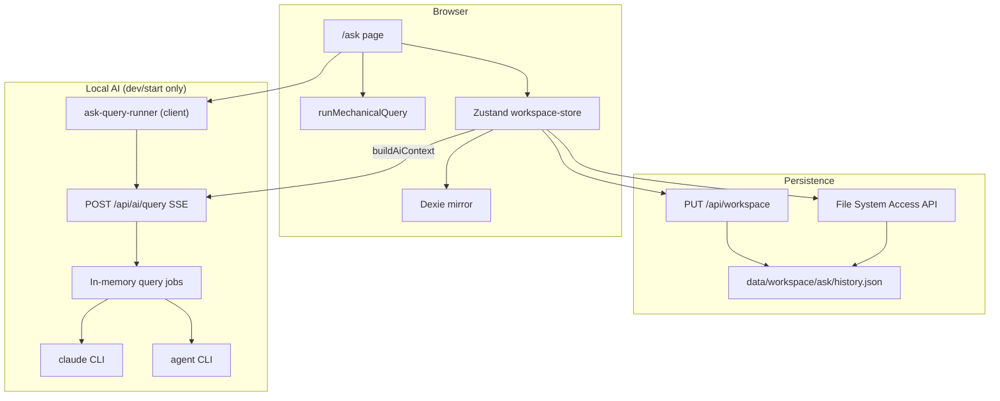

# Ask desk

**Ask desk** is the natural-language query surface inside [Paper Desk](../README.md). It answers questions about your workspace—WIP, deadlines, urgency, assignees, and inbound/outbound links—using **mechanical** (local, zero-token) templates first, with optional **CLI-backed AI** for free-form questions.

Routes: `/ask` (main UI), `/ask/archive` (archived responses).

---

## Architecture

Paper Desk is a **Next.js 16** app with an **offline-first** data model: JSON on disk (or a user-linked folder) is the source of truth; the browser keeps an **IndexedDB** mirror via Dexie. **Zustand** (`workspace-store`) holds the in-memory `WorkspaceSnapshot` and coordinates reads/writes.

Ask desk sits entirely on the **client** for mechanical queries and uses a **server route** only to spawn local AI CLIs (Node `child_process`).



| Layer | Role |
|-------|------|
| `src/app/ask/*` | Ask desk pages |
| `src/lib/query/mechanical.ts` | Template matching + markdown answers |
| `src/lib/ai/providers.ts` | Provider/model IDs and Claude flag mapping |
| `src/app/api/ai/query/route.ts` | SSE stream + GET job status; spawns CLI via job registry |
| `src/lib/ai/query-jobs.ts` | In-memory jobs, stdout chunks, 120s timeout |
| `src/lib/ask/ask-query-runner.ts` | Global client runner, reconnect/reconcile |
| `src/lib/store/workspace-store.ts` | Ask history CRUD including pending/running/failed |
| `src/lib/types/schemas.ts` | `AskHistoryEntry`, `WorkspaceSnapshot.askHistory` |
| `data/workspace/ask/history.json` | On-disk ask history (`WORKSPACE_PATHS.askHistory`) |

**Hydration merge:** On load, server snapshot is merged with the IDB cache; ask history entries are unioned by `id`, keeping the newer `respondedAt`. If merged active history is ahead of the server, a best-effort `PUT /api/workspace` syncs ask history back (`merge.ts`, `askHistoryNeedsSync`).

---

## Pages

| Route | File | Purpose |
|-------|------|---------|
| `/ask` | `src/app/ask/page.tsx` | Query input, template chips, provider/model overrides, active history |
| `/ask/archive` | `src/app/ask/archive/page.tsx` | Archived responses (`filter="archived"`) |

Shared UI:

- `QueryTemplateChips` — one-click template runs
- `AskHistoryList` — history grouped by day (`groupAskHistory.ts`), markdown via `AskAnswerMarkdown`

Nav label **Ask desk** in `AppShell`; active for any path under `/ask`.

---

## Capabilities

### Mechanical templates (no API tokens)

Defined in `QUERY_TEMPLATES` / `runMechanicalQuery` (`src/lib/query/mechanical.ts`). Matching uses exact template id/prompt, substring prompts, or regex heuristics (e.g. `wip`, `overdue`, `assignee`).

| Template ID | Chip label | What it reports |
|-------------|------------|-----------------|
| `wip` | WIP status | WIP limit, inbound/outbound active vs backlog counts |
| `overdue` | Overdue tasks | Open tasks with `dueDate` before today |
| `due_week` | Due in 7 days | Open tasks due within 7 days |
| `blocked_delayed` | Blocked & delayed | `status` blocked or delayed |
| `high_urgency` | High urgency (4–5) | Open tasks with urgency ≥ 4 |
| `inbound_unlinked` | Inbound without outbound | Open inbound tasks with no entry in `links.json` |
| `by_assignee` | Summary by assignee | Open task counts per assignee (up to 5 lines each) + unassigned |

Answers are **GitHub-Flavored Markdown** (lists, bold task lines).

### Ask history

Each response is stored as an `AskHistoryEntry`:

- `prompt`, `answer`, `source` (`mechanical` | `ai`)
- Optional `provider`, `model`, `templateId`
- `respondedAt`, `archived` (default `false`)
- `status`: `running` | `completed` | `failed` (default `completed` for older rows)
- Optional `startedAt`, `jobId`, `errorMessage` while AI is in flight or failed

**Archive** hides an entry from `/ask` but keeps it on `/ask/archive`. History persists in the workspace snapshot and `ask/history.json`.

### Query execution flow (`/ask`)

1. Run `runMechanicalQuery(snapshot, text, templateId?)`.
2. If **Use AI** is **unchecked** and mechanical **matched** → save mechanical answer and stop.
3. Otherwise → create a **running** history row, then `POST /api/ai/query` (SSE) with `entryId`, `prompt`, `provider`, `model`, and `context` from `buildAiContext`.
4. CLI stdout is streamed as SSE `chunk` events; partial text is shown in history and persisted periodically.
5. On `done` → finalize row as `completed` / `source: "ai"`.
6. On `error` or client/server timeout → row `failed` with `errorMessage`; mechanical fallback text may remain in `answer` if a template had matched.

**Navigation:** While a query is running, leaving `/ask` (except `/ask/archive`) prompts for confirmation; the CLI job keeps running on the server. Returning to Ask desk reconciles via `GET /api/ai/query?jobId=`.

**Ghost guards:** Stream must end with `done` or `error`; unexpected disconnect reconciles against the job snapshot; stale `running` rows without a job fail after timeout or 404.

**Use AI** checkbox: when enabled, mechanical short-circuit is skipped so templates can go through the CLI (still with workspace context).

Provider/model on the Ask page override session defaults from `settings.json`; defaults are edited under **Settings → AI defaults**.

### Workspace context for AI

`buildAiContext` sends a compact text block: WIP limit, active count, inbound/outbound open counts, and up to **15** open tasks sorted by urgency (direction, title, status, urgency, due, delivery). It does not include full note bodies or schedule details unless the model infers from task fields.

---

## API

All routes are Next.js App Router handlers under `src/app/api/`.

### `GET /api/workspace`

Loads workspace from `PAPER_DESK_DATA_DIR` or `data/workspace`. Creates an empty workspace if missing.

**Response:** `{ snapshot, root, initialized }`

### `PUT /api/workspace`

**Body:** `{ snapshot: WorkspaceSnapshot, audit?: object }`

Validates with Zod, writes all workspace files (including `ask/history.json`), optionally appends one line to `audit.log.jsonl`.

**Response:** `{ ok: true }`

### `POST /api/workspace/init`

**Body:** `{ example?: boolean }`

Creates empty or example workspace on disk.

**Response:** `{ snapshot, root }`

### `POST /api/ai/query`

Used by Ask desk for CLI AI. **Local dev/start only** (requires `claude` and/or `agent` on PATH).

**Body:**

| Field | Type | Required | Description |
|-------|------|----------|-------------|
| `entryId` | UUID string | yes | Client history row id |
| `provider` | `"claude"` \| `"cursor"` | yes | Which CLI to spawn |
| `model` | string | no | Short id (mapped for Claude) or Cursor model id |
| `modelCliArg` | string | no | Resolved CLI model flag |
| `prompt` | string | yes | User question |
| `context` | string | no | Workspace context appended after `--- Workspace context ---` |

**Response:** `Content-Type: text/event-stream` with JSON `data:` events:

| Event | Payload |
|-------|---------|
| `job` | `{ jobId }` |
| `chunk` | `{ text }` stdout fragment |
| `done` | `{ output }` full trimmed stdout |
| `error` | `{ message }` |

If the browser disconnects, the CLI process **continues**; poll job status with GET.

**Errors:** `400` (missing/invalid input). CLI failures arrive as SSE `error` (job status `failed`, 120s timeout).

### `GET /api/ai/query?jobId=`

**Response:** `{ status, partialOutput, output?, error?, entryId, startedAt, finishedAt? }`

**404** if the job expired (in-memory jobs are cleared ~30 minutes after completion, or lost on server restart).

The server prepends a format hint: reply in GFM, use pipe tables for tabular data.

---

## AI

### Design

Ask desk does **not** call cloud APIs directly. The Next server runs **local CLIs**:

| Provider | Command | Models (UI id → CLI) |
|----------|---------|----------------------|
| **Claude** | `claude -p "<prompt>" --model <flag>` | haiku → `claude-haiku-4-5`, sonnet → `claude-sonnet-4-6`, opus → `claude-opus-4-6`, fable → `claude-fable-5-1` |
| **Cursor** | `agent -p "<prompt>" --model <model>` | auto, composer, gpt-5, claude-sonnet (default `auto` if empty) |

Defaults live in workspace settings:

```json
{
  "aiProvider": "claude",
  "aiModel": "sonnet"
}
```

(`SettingsSchema` in `src/lib/types/schemas.ts`)

### Mechanical vs AI

| Aspect | Mechanical | AI (CLI) |
|--------|------------|----------|
| Cost | No tokens | Uses local CLI / subscription |
| Data leave machine | No | Prompt + context sent to CLI |
| Best for | Template chips, keyword-style questions | Paraphrases, synthesis, non-template questions |
| Offline | Yes (needs loaded snapshot) | No (needs running Next server + CLI) |

### Requirements

- `pnpm dev` or `pnpm start` so `/api/ai/query` is available
- `claude` on PATH for Claude provider
- `agent` (Cursor CLI) on PATH for Cursor provider
- Ask history and mechanical answers work without AI when templates match and **Use AI** is off

### Related files

- `src/lib/ai/providers.ts` — provider types and model lists
- `src/app/api/ai/query/route.ts` — spawn, timeout, prompt assembly
- `src/lib/ask/normalizeMarkdown.ts` — markdown normalization for display (if used by renderer)

---

## Data model snippet

```typescript
// AskHistoryEntry (persisted in snapshot + ask/history.json)
{
  id: uuid,
  prompt: string,
  answer: string,
  source: "mechanical" | "ai",
  provider?: "claude" | "cursor",
  model?: string,
  templateId?: string,
  respondedAt: ISO8601,
  archived: boolean,
  status?: "running" | "completed" | "failed",
  startedAt?: ISO8601,
  jobId?: uuid,
  errorMessage?: string
}
```

---

## See also

- [Paper Desk README](../README.md) — workspace layout, WIP, folder mode
- [docs/electron.md](./electron.md) — planned desktop packaging
